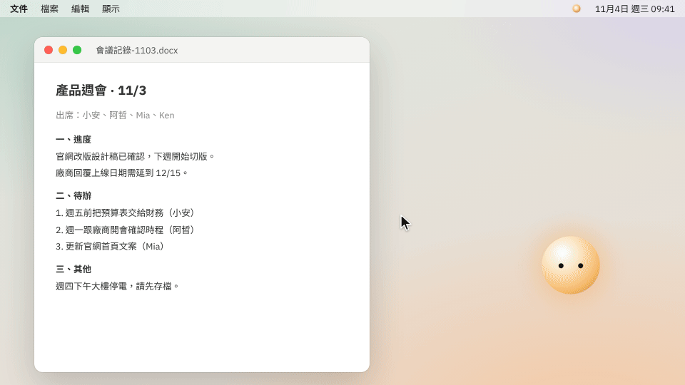
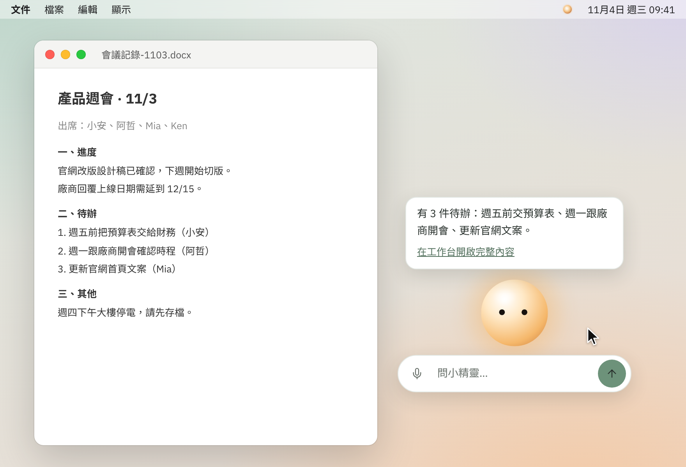
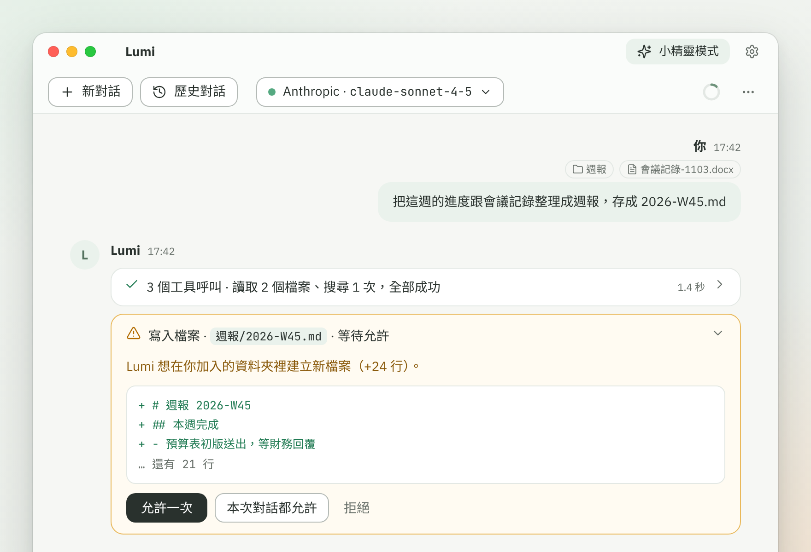
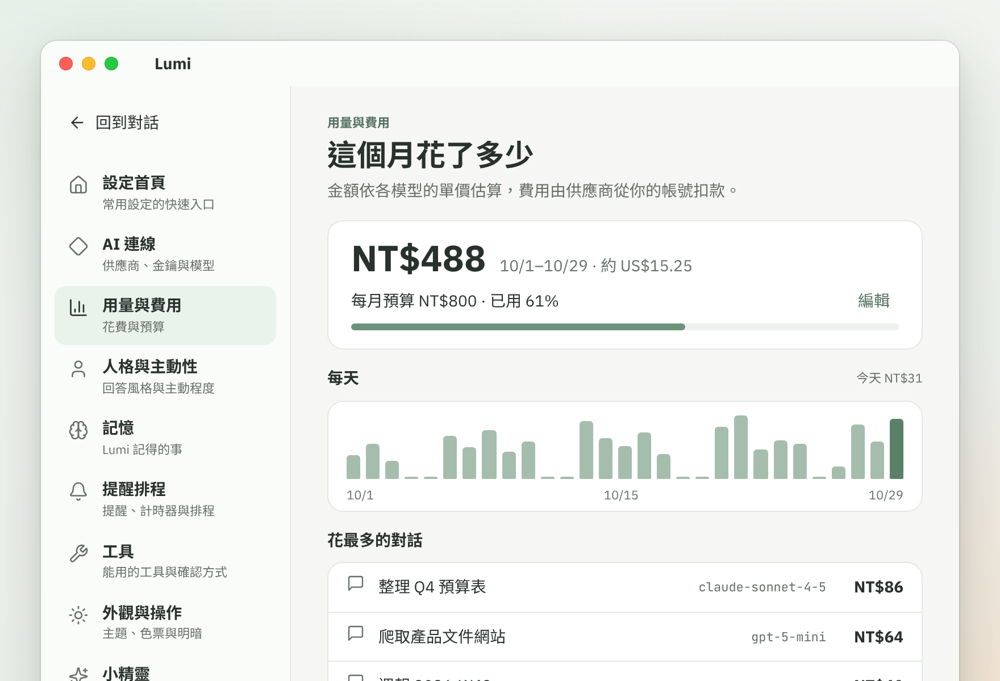
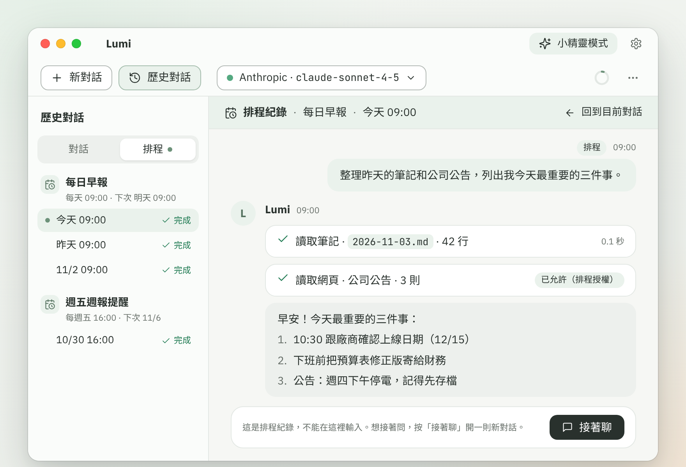
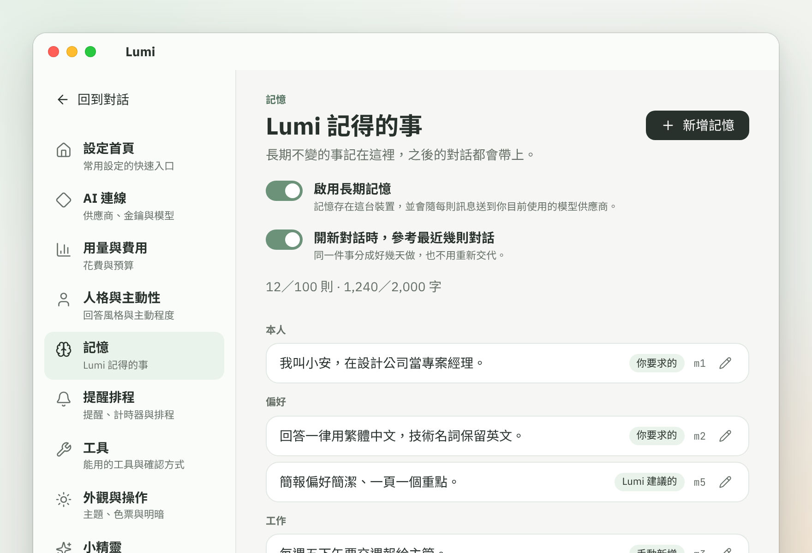
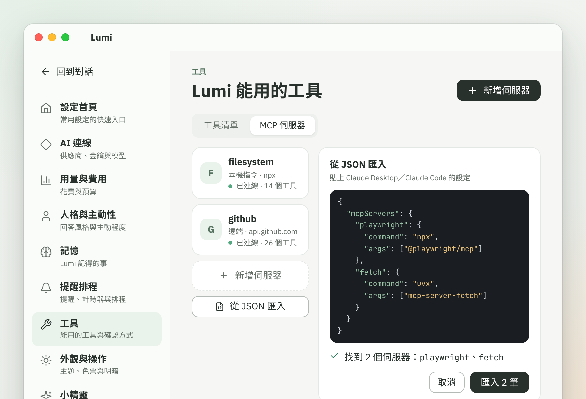
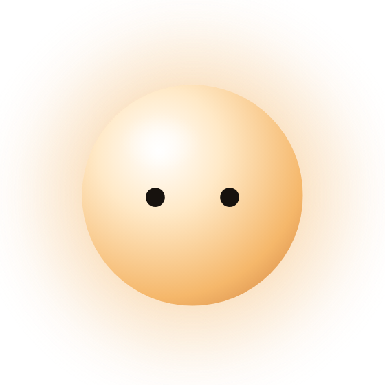
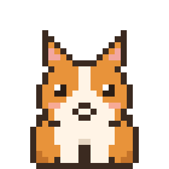

<div align="center">


# Lumi

**住在你桌面上的 AI 小精靈。**
平常安靜地待在角落，需要時一叫就到；要做正事，就展開成完整的工作台。

[](https://github.com/NEILLOG/Lumi/releases/latest)




[**⬇ 下載 Windows／macOS 版**](https://github.com/NEILLOG/Lumi/releases/latest) · [使用教學](docs/guide/README.md) · [功能一覽](#-亮點) · [打造你的小精靈](#-打造你自己的小精靈) · [從原始碼建置](#-技術棧與建置)

</div>

---

## 為什麼是 Lumi？

大多數 AI 助理都住在瀏覽器分頁裡：要用時切過去，用完就忘了它。
Lumi 換個方向——它是一個**有樣子、有反應**的桌面角色。你在寫報告、開會、整理檔案時，它就在旁邊；問一句，它用一個氣泡回答你。問題變複雜了，一鍵切到工作台，**同一段對話**接著聊，什麼都不用重講。

而且它不只會聊天：讀你的文件、整理資料夾、上網查資料、幫你操作瀏覽器、每天早上自動幫你整理事情——每一個會動到東西的動作，都會先問過你。

---

## ✨ 亮點

<table>
<tr>
<td width="50%" valign="top">

### 🫧 兩種模式，同一段對話
**小精靈模式**是一個透明、無框的桌面角色，游標靠近才浮出輸入列，回答簡短、不打擾。它會用動畫告訴你現在在聆聽、思考、使用工具還是已經完成。
**工作台模式**則是完整的對話視窗。兩邊共用同一段對話，隨時切換。

</td>
<td width="50%" valign="top">



</td>
</tr>
<tr>
<td valign="top">



</td>
<td valign="top">

### 🛠 會動手做事，但每一步都先問你
讀 Word、Excel、PowerPoint、PDF；在你指定的資料夾裡建立、整理檔案；寫每日筆記（相容 Obsidian）、設提醒與計時器；讀網頁、爬整個網站存成 Markdown；**直接操作電腦上的 Edge 或 Chrome**，不用另外安裝 Node。
每個工具都有風險等級：寫入要確認、破壞性的動作一律先問，遇到登入或驗證碼，Lumi 會請你自己輸入，不會替你填密碼。

</td>
</tr>
<tr>
<td valign="top">

### 🔑 你的金鑰、你的模型、你看得到花費
自帶 API 金鑰（BYOK），支援 Anthropic 與所有 OpenAI 相容服務——OpenAI、Ollama 本機模型、公司的 AI Gateway 都能接。金鑰只存在系統的安全儲存（Windows DPAPI／macOS Keychain）。
內建**用量與費用**頁：每月花費、預算提醒、CSV 匯出；地端模型自動判定不計費。

</td>
<td valign="top">



</td>
</tr>
<tr>
<td valign="top">



</td>
<td valign="top">

### ⏰ 排程：跟它說一聲，時間到自己做
「每天早上 9 點幫我整理昨天的筆記」——建立時先確認它能用哪些工具，之後就讓它自己跑。結果放在歷史對話的「排程」分頁，看完還能接著聊。

</td>
</tr>
<tr>
<td valign="top">

### 🧠 記得你，也記得你最近在忙什麼
**長期記憶**記住你的身分、偏好與手上的專案；**近況**讓新對話自動接上最近幾則對話的脈絡——同一件事拆成好幾天做，不用每次重新交代。
所有記憶都能在設定裡檢視、修改、刪除或整個關閉，寫入記憶一律先問你。
做完一件事，說一句「把剛才的流程存成**技能**」，下次遇到同樣的事它就照這套方法做，也能匯入同事分享的技能（[怎麼用](docs/guide/skills.md)）。

</td>
<td valign="top">



</td>
</tr>
<tr>
<td valign="top">



</td>
<td valign="top">

### 🔌 接上 MCP，能力無限延伸
支援多個 MCP 伺服器（本機指令或遠端 HTTP），直接**貼上 Claude Desktop／Claude Code 的設定 JSON** 就能匯入。MCP 的工具跟內建工具一樣列在工具清單、一樣先確認，回傳的截圖也會直接顯示在回覆裡。
熟悉指令的人還可以開啟**執行指令**（預設關閉），讓 Lumi 執行 PowerShell、cmd 或 bash，例如安裝 npm 套件、查詢電腦狀態；每次都會先讓你看完整指令（[怎麼用](docs/guide/commands.md)）。

</td>
</tr>
</table>

<details>
<summary><b>還有更多……</b></summary>

- 🎙 **語音輸入**：工作台與小精靈都能直接說話，透過 Whisper 轉成文字
- 🎭 **人設**：調整個性、積極度，或寫一段自己的人設；小精靈模式會自動回得更短
- 📎 **檔案與資料夾上下文**：資料夾不會整包塞進 prompt，模型只在你給的範圍內按需讀取
- 🖼 **圖片直接出現在回覆裡**：點開就能縮放、拖曳
- 🔮 **塔羅牌**：單張、三張、凱爾特十字（僅供娛樂與自我反思 😉）
- 🗂 **歷史對話**：搜尋、依日期分組、改名、刪除
- 🌗 **淺色／深色主題**，跟隨系統；Windows 與 macOS 用同一套內建字型，畫面一致
- 🌐 **企業網路友善**：Proxy（系統／PAC／手動，支援 AD 驗證）一次設定、全部連線套用
- 🔄 **App 內更新通知**

</details>

---

## 🐾 打造你自己的小精靈

小精靈的「殼」和「角色」是分開的。除了程式繪製的光球，也可以用**美術素材＋一份 `manifest.json`** 做出自己的角色——每個狀態（閒置、聆聽、思考、使用工具、完成、睡覺、被戳……）各一張 sprite sheet，丟進角色資料夾、按「重新載入」就能換上。

<table>
<tr>
<td align="center" width="33%">
<br>
<b>光球</b><br><sub>程式繪製・會呼吸・閒置自動降幀省電</sub>
</td>
<td align="center" width="33%">
<br>
<b>柯基</b><br><sub>像素風素材角色</sub>
</td>
<td align="center" width="33%">
<br>
<b>機器人</b><br><sub>像素風素材角色</sub>
</td>
</tr>
</table>

👉 規格與檢查清單：[角色開發指南](docs/sprite-dev-guide.md) · 範例素材：[`samples/sprites/`](samples/sprites/)

---

## 🔒 你的資料留在你這裡

- 金鑰、Token、MCP 環境變數只存在這台裝置的安全儲存，不寫進任何設定檔或 log
- 對話、記憶都存在本機；只會送到**你自己選的**模型供應商
- 檔案工具只能碰你加入的檔案與資料夾，範圍外一律拒絕
- 瀏覽器使用 Lumi 專屬的設定檔，不讀你平常瀏覽器的 Cookie
- Lumi 只會自動連到對話中出現過的網站，其他網站先問你

---

## 🚀 開始使用

1. 到 [Releases](https://github.com/NEILLOG/Lumi/releases/latest) 下載
   - **Windows**：`Lumi-x.y.z-win-x64.zip`，解壓後執行 `Lumi.exe`
   - **macOS（Apple Silicon）**：`Lumi-x.y.z-osx-arm64.zip`，解壓後打開 `Lumi.app`
2. 打開 **設定 › AI 連線**，新增連線、貼上你的 API 金鑰，再在連線底下新增模型
3. 開始聊，或按右上角切換成小精靈 ✨

第一次用、或想知道某個功能怎麼設定，請看 **[使用教學](docs/guide/README.md)**：從[開始使用](docs/guide/getting-started.md)到[常見問題與錯誤訊息](docs/guide/troubleshooting.md)都有。也可以直接問 Lumi，它會查這份說明回答你。

<!-- TODO macOS 尚未簽章與公證：第一次開啟若被擋，請在 Finder 按右鍵 › 打開。簽章完成後移除這行 -->
> macOS 版目前尚未簽章，第一次開啟若被系統擋下，請在 Finder 對 `Lumi.app` 按右鍵 › 打開。

---

## 🧩 技術棧與建置

**.NET 10** · **Avalonia 11.3** · CommunityToolkit.Mvvm · Generic Host（DI）· SQLite · Markdig · Playwright · MCP C# SDK

- 核心（`Lumi.Core`）不依賴任何 UI，對話迴圈、工具、Prompt 分層都在這裡；供應商、瀏覽器、MCP 等外部套件各自封裝在自己的專案
- 工具統一實作 `ITool` 介面、以 DI 註冊，權限等級與可用模式由框架統一處理
- 小精靈透過 `Lumi.Sprites.Abstractions` 抽象層接入，新增角色不需要改殼

```bash
git clone --recurse-submodules https://github.com/NEILLOG/Lumi.git
cd Lumi
dotnet build
dotnet run --project src/Lumi.App
```

需要 [.NET 10 SDK](https://dotnet.microsoft.com/download)。專案結構、開發流程與維護注意事項見 [開發者文件](docs/development.md)。

---

## 授權

本專案以 [MIT 授權](LICENSE)釋出。第三方資料與字型各依其授權：模型價目表來自 [LiteLLM](https://github.com/BerriAI/litellm)（MIT），流程圖用內嵌的 [Mermaid](https://github.com/mermaid-js/mermaid)（MIT，見 [`src/Lumi.Browser/Assets/mermaid.LICENSE.txt`](src/Lumi.Browser/Assets/mermaid.LICENSE.txt)），字型授權見 [`src/Lumi.App/Assets/Fonts/LICENSES/`](src/Lumi.App/Assets/Fonts/LICENSES/)。塔羅牌核心庫 [TarotMcp](https://github.com/NEILLOG/TarotMcp) 是獨立的 repo，不在此授權範圍內，授權尚未決定。
