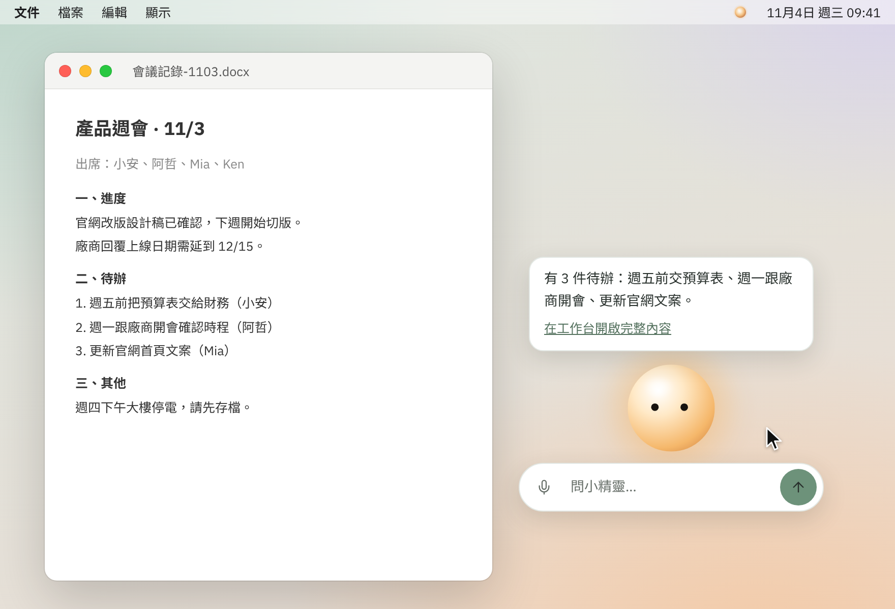

# 開始使用

> 第一次打開 Lumi：準備 API 金鑰、設定模型、送出第一則對話，並試著讓它讀一個檔案。

## Lumi 是什麼？

Lumi 是在你電腦桌面上執行的 AI 助理，Windows 與 macOS 都能用。你可以問它問題、請它讀文件、整理檔案；它要動到檔案或資料時，預設會先問你。

Lumi 本身不附 AI 模型，要連到你自己申請的 AI 服務，並使用你自己的「API 金鑰」。API 金鑰像一組專屬密碼，讓 AI 服務知道是你在使用；費用由供應商依用量計算，從你的帳號扣款，不是 Lumi 收費。金鑰要到 AI 服務的官網登入後建立，各家的申請頁面列在下面的「常見服務怎麼填？」。

Lumi 有兩種畫面，共用同一則對話，可以隨時切換：

- **工作台**：完整的對話視窗，第一次打開看到的就是它。
- **小精靈**：待在桌面角落的小角色，問一句、回一小段；點氣泡裡的「在工作台開啟完整內容」就會切到工作台，接著聊。

## 開始前要準備什麼？

1. **打開 Lumi。** Windows：解壓縮下載的 zip，執行 `Lumi.exe`。macOS：解壓縮後打開 `Lumi.app`；目前尚未簽章，第一次若被系統擋下，請在 Finder 對 `Lumi.app` 按右鍵，選「打開」。
2. **一組 AI 服務的 API 金鑰**，或別人提供給你的連線網址與金鑰。如果只用 Ollama 這類在自己電腦上執行的模型，可以不需要金鑰。
3. **這台電腦連得到那個 AI 服務。** 如果你在公司網路裡，連不上時請看[網路與 Proxy](network.md)。

## 第一次設定：接上 AI 服務

Lumi 第一次啟動時沒有任何連線與模型，要自己新增。「連線」記錄要連到哪個服務、用哪把金鑰；「模型」是你要用的那個 AI 模型。一個連線底下可以有多個模型。

1. 打開 Lumi。工作台上方的模型按鈕會寫著「未設定模型，點此開啟設定」。
2. 點視窗右上角的齒輪圖示「設定」。設定視窗會先開在「設定首頁」，「待處理」裡有一項「還沒有設定模型」，點它的「前往設定」；也可以直接點左邊的「AI 連線」。
3. 點頁面右上角的「新增連線」。
4. 在「名稱」填一個你看得懂的名字，例如 `OpenAI`。這個名稱只有你會看到。
5. 在「API 金鑰」貼上金鑰。想確認有沒有貼對，可以按「顯示」。
6. 展開「進階」，依下一節的表格確認「供應商格式」與「Base URL」。不用改的話保持預設就好。
7. 按「測試連線」。成功會顯示「成功 · 可用模型 N 個」；失敗的處理方式見[常見問題與錯誤訊息](troubleshooting.md)。
8. 按「儲存」。畫面會提示「連線已儲存。接著在清單中這個連線底下「新增模型」。」
9. 在「連線與模型」清單裡，這個連線底下點「新增模型」。
10. 在「模型 ID」的下拉選單選一個模型。測試連線成功時，清單會列出這個服務提供的模型。「顯示名稱」預設和模型 ID 一樣，可以改成好記的名字。其他欄位先用預設值。
11. 按「儲存」。第一個模型會自動成為「預設模型」，工作台與小精靈都用它；工作台上方的按鈕也會改成「連線名稱 · 模型 ID」，表示設定完成。

金鑰只存在這台電腦：Windows 用你的登入帳號加密保存，macOS 放在鑰匙圈，不會出現在對話、對話資料庫或記錄檔裡。儲存後畫面只會顯示「已設定 · 結尾 xxxx」，不會再顯示完整金鑰。

## 常見服務怎麼填？

| 服務 | 供應商格式 | Base URL | API 金鑰 |
|---|---|---|---|
| Anthropic | Anthropic 原生 | `https://api.anthropic.com` | 需要（[申請金鑰](https://platform.claude.com/settings/keys)） |
| OpenAI | OpenAI 相容 | `https://api.openai.com/v1` | 需要（[申請金鑰](https://platform.openai.com/api-keys)） |
| DeepSeek | OpenAI 相容 | `https://api.deepseek.com` | 需要（[申請金鑰](https://platform.deepseek.com/api_keys)） |
| Ollama（本機模型，要先[安裝 Ollama](https://ollama.com/download)） | OpenAI 相容 | `http://localhost:11434/v1` | 可以留空 |

- 新增連線時，「供應商格式」預設是「OpenAI 相容」，「Base URL」預設是 OpenAI 的位址。改選「Anthropic 原生」時，只要你還沒自己改過網址，「Base URL」會跟著換成 Anthropic 的位址。
- 多數第三方與本機服務都選「OpenAI 相容」。這類服務的 Base URL 結尾通常要有 `/v1`（上表的 DeepSeek 不用），漏掉時常會看到「找不到指定的模型，或 Base URL 不正確」。
- 網址要完整，以 `http://` 或 `https://` 開頭。
- 刪除連線、上下文上限、單價等更多設定，見 [AI 連線與模型](connections.md)。

## 送出第一則對話

1. 點工作台下方的輸入框，輸入想問的話，例如「用三句話介紹你自己」。
2. 按 Enter 送出；要換行請按 Shift+Enter。也可以按右邊的送出鈕。
3. 回覆會一段一段出現。回應進行中，送出鈕會變成「停止」，按下去就會停止這次回應。
4. 回覆完成後，回覆下方有「複製」；最後一則回覆還有「重新產生」，可以讓 Lumi 重答一次。

送出時如果缺金鑰或金鑰無效，Lumi 會自動開啟設定視窗，停在該連線的金鑰欄位；存好金鑰後會自動重送。其他錯誤會顯示在對話下方，並附「重試」按鈕，原因與處理方式見[常見問題與錯誤訊息](troubleshooting.md)。

## 試著讓它讀一個檔案

1. 按輸入框下方的「加入檔案」選一個檔案，也可以直接把檔案拖進視窗。純文字檔、Word、Excel、PowerPoint、PDF 都可以（不含舊格式 .doc、.xls、.ppt）。
2. 輸入框上方的「此對話的上下文」會列出加入的檔案。輸入「請幫我整理這份檔案的重點」並送出。
3. 送出後，文字檔旁會出現「已帶入」，表示內容已經交給模型。Word、Excel、PowerPoint、PDF 不會直接帶入，Lumi 會在需要時用「讀取文件」工具讀取。
4. 檔案旁的「移除」可以把它從這則對話拿掉。

Lumi 只能讀你加進這則對話的檔案和資料夾。加入的資料夾裡，看起來像金鑰或憑證的檔案（例如 `.env`、`.pem`、`.key`，或 `id_rsa` 開頭的檔案）也會被排除；你直接加入的單一檔案不受這項限制。

### 它要改動檔案時會先問你

只讀取檔案不需要確認。要新增、覆寫、複製、移動檔案或建立資料夾時，Lumi 會先在對話裡顯示確認卡片，列出它要做什麼，等你決定。例如加入一個資料夾，然後說「把重點存成 重點.txt」：

- 「寫入檔案」這類一般的寫入：按「允許一次」才會執行，也可以選「本次對話都允許」，或按「拒絕」。
- 「覆寫檔案」這類會覆蓋或刪除內容的操作：卡片會註明「這個操作無法復原」，每次都要按「允許執行」才會做；按「拒絕」就不會動。

這些會改動檔案的工具只能在工作台使用。更多說明見[加入檔案與資料夾](files.md)與[工具與權限確認](tools.md)。

## 接下來可以看什麼？

- [對話與歷史紀錄](chat.md)：開新對話、找回以前的對話。
- [加入檔案與資料夾](files.md)：檔案與資料夾的差別、支援的格式。
- [小精靈](sprite.md)：切換模式、換角色、小精靈能做什麼。
- [工具與權限確認](tools.md)：Lumi 有哪些工具，怎麼控制它們。
- [常見問題與錯誤訊息](troubleshooting.md)：看到錯誤訊息時查這裡。
