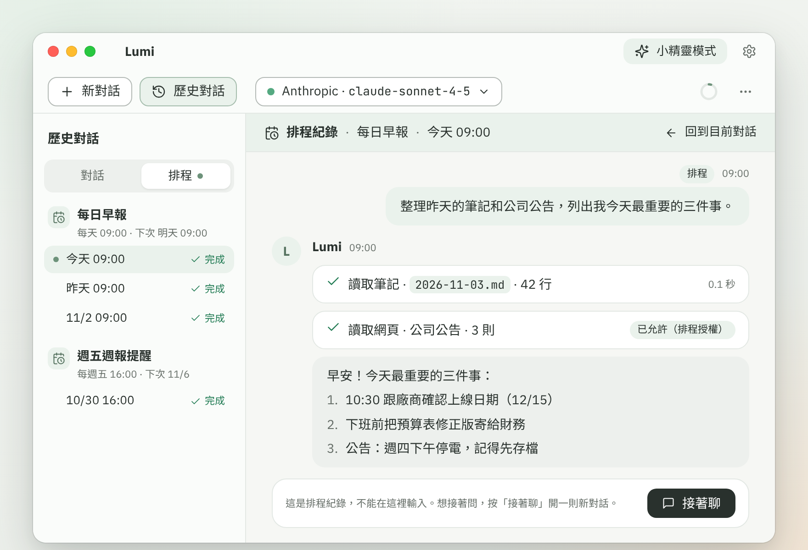

# 提醒、計時器與排程

> 請 Lumi 提醒你、開計時器、排定時間自動做事，以及管理提醒、看排程紀錄；Lumi 沒開著時到點會怎樣。

三種東西都是在對話裡請 Lumi 建立，設定頁只能查看、啟停、刪除，以及編輯排程的內容，不能新增：

- **提醒**：指定時間（或每天、週一到週五、每週特定星期、每月固定日期）在 Lumi 裡跳出通知。
- **計時器**：倒數計時，時間到跳出通知。時間從 10 秒到 24 小時。
- **排程**：到點時 Lumi 自己跑一段你交代的指令，你不用在電腦前。結果放在歷史對話的「排程」分頁。

## 怎麼建立提醒或計時器？

直接在對話裡說，例如「十分鐘後提醒我關火」「每天早上九點提醒我寫日報」「幫我計時 25 分鐘」。Lumi 會用「建立提醒」或「啟動計時器」工具設定，小精靈和工作台都可以。

1. 說出時間與要提醒的內容。時間以這台電腦的時區計算；要用別的時區，在句子裡講明。
2. 設定前，預設會先出現確認卡，列出標題與解析後的時間，按「允許一次」才會建立。
3. 設定完成後，到點會在 Lumi 裡跳出通知。

通知只出現在 Lumi 裡（工作台的通知列或小精靈的氣泡），不是系統通知。通知不會自動消失，要按「關閉」才會收起，最多保留 20 則。

要查詢、取消或暫停，也是對 Lumi 說，例如「我有哪些提醒」「取消早上九點那個」「先暫停每天的日報提醒」。這些對應「列出提醒」「取消提醒」「啟用或停用提醒」工具。

## 怎麼建立排程？

排程要在工作台建立，小精靈不能建。對 Lumi 說「每天早上 9 點幫我整理這個資料夾的新檔案」，Lumi 會用「建立排程」工具，並出現一張確認卡。排程執行時沒有人可以回答問題，所以指令要能一次做完；Lumi 會把你的話寫成完整的指令。

確認卡上有這些欄位：「名稱」「時間」「要做的事」「模型」（用工作台的預設模型）「紀錄」（保留最近 30 次）和「可以存取的資料夾」。可以存取的範圍只有你建立當下，這則對話裡已經加入的檔案和資料夾；沒有加入就不能讀檔，只能用筆記。要讓排程讀某個資料夾，先把它[加入對話](files.md)，再請 Lumi 建立。

### 確認卡上的「執行時不再詢問的動作」是什麼意思？

排程跑的時候你不在旁邊，沒辦法逐一按允許，所以要在建立時一次決定哪些動作可以自動進行：

- **讀取資料**：固定勾選，讀檔案、網頁、筆記本來就不會詢問。
- **寫入**：建立或修改檔案與筆記，也包括外部工具（MCP）的寫入動作。
- **網路**：開啟網頁、呼叫外部服務。
- **破壞性操作**：刪除檔案、清空資料夾等，標示「無法復原」，預設不勾，要你自己勾。勾了以後，按鈕會變成紅色的「建立排程（含破壞性操作）」。

Lumi 會依你要做的事先勾好標示「Lumi 建議」的項目，你可以調整。沒勾的動作，執行到時排程會暫停並通知你。確認後按「建立排程」，不想建就按「拒絕」。

有幾類動作不管勾什麼，執行時一律要問你：寫入記憶、上傳檔案、等你登入、管理排程，以及連到之前沒出現過的網站。

## 排程執行時超出授權會怎樣？

排程做到一個沒授權的動作時，那一次執行會暫停，狀態變成「待確認」，並通知你「『名稱』需要你確認」。按通知的「查看」打開那筆紀錄，卡片上會寫是哪個動作沒有授權，你可以：

- 按「允許一次」：只這一次放行，排程接著做。
- 按「以後都允許（加入排程授權）」：放行，並把這類動作加進排程的授權，之後不再問。允許破壞性操作時會再確認一次。
- 按「拒絕」：不做這個動作。

沒有人回應時，這次執行會停在待確認；同一個排程下一次到點時，上一次還在等的會被結束。待確認的執行不會擋住別的排程。

## 在哪裡看排程跑得怎樣？

1. 在工作台點「歷史對話」打開歷史抽屜，切到「排程」分頁（有沒看過的紀錄時，分頁會有提示）。
2. 每個排程一組，底下是最近的執行紀錄，由新到舊。每筆有狀態和時間，沒看過的有圓點。狀態有「執行中」「待確認」「完成」「失敗」「錯過」「中斷」；補跑與按「立即執行」跑的還會多一個「補跑」或「立即執行」標籤。
3. 點一筆就能看當時 Lumi 做了什麼。紀錄是唯讀的，不能在裡面輸入；想接著問，按「接著聊」，會在「對話」分頁開一則新對話並引用這筆結果，原本的紀錄不會改變。
4. 組標題右邊的「⋯」可以「立即執行」、停用或重新啟用、「在設定中編輯」，或「刪除這些紀錄」。單筆紀錄的「⋯」可以刪除那一筆；執行中或待確認的不能刪。
5. 看到「錯過」「中斷」或「失敗」的紀錄，可以按「現在執行」重跑一次；執行中的可以按「停止這次執行」。

每個排程只保留最近 30 次紀錄，更舊的會連同內容自動刪除。每次執行都會呼叫 AI 模型，由供應商照一般對話計費。同一時間只有一個排程在呼叫模型，其他的排隊。

## Lumi 沒開著的時候，提醒會響嗎？

**不會。** 提醒、計時器和排程都要 Lumi 在執行才會觸發，它不是系統的鬧鐘。Lumi 沒開、電腦關機或睡眠時，到點什麼都不會發生。下次打開 Lumi（或電腦睡眠喚醒）時，Lumi 會檢查錯過了什麼：

- **一次性的提醒與計時器**：只晚 2 分鐘以內，照常通知；超過 2 分鐘就不通知，標成「已錯過」，並彙總成一則「你錯過了 N 個提醒或排程」，最多列出 5 個標題。
- **每天、每週、每月的提醒**：不管錯過幾次，只補通知一次，然後排到下一次。
- **排程**：錯過 2 小時以內，開啟後補跑一次，紀錄上有「補跑」標籤；超過 2 小時不執行，只在紀錄留一筆「錯過」，寫著「這次沒有執行，當時 Lumi 沒有開啟。」週期排程不管錯過幾次，都只補跑一次，再排到下一次。
- **執行到一半 Lumi 被關掉**：那一次標成「中斷」，不會自動重跑。

所以需要準時的事，請讓 Lumi 保持開著。工作台模式下關掉工作台視窗，就是結束 Lumi；小精靈模式下 Lumi 會留在桌面角落。想登入電腦就自動開啟，到設定 › 外觀與操作勾選「開機後自動啟動 Lumi」（只有安裝後的正式版能設定）。

## 在設定裡可以管理什麼？

設定 › 提醒排程分成「待觸發」和「已結束」兩個清單。每一列有標題、種類（提醒、計時器、排程）、動作（「通知」，或「跑 prompt」，代表排程跑指令）、內容、下次觸發時間，以及這是「由 Lumi 建立」還是「由你建立」。

- **啟停**：待觸發的項目有開關。關掉後不會觸發，也不會被當成錯過，項目仍保留。重新打開時會重新算下一次的時間；一次性的項目如果時間已過，就無法再啟用。
- **刪除**：按列右側的刪除並確認。刪除排程時，會另外問要不要一併刪除它的執行紀錄。
- **清除已結束**：把「已完成」「已錯過」「已取消」的項目一次清掉。不按的話，系統也會在 30 天後自動清除。
- **編輯排程**：只有跑指令的排程有「編輯」。展開後可以改「要做的事」、勾選或取消「執行時不再詢問的動作」、移除「可以存取的資料夾」，再按「儲存」。資料夾只能移除，不能新增；要新增，先在對話裡加入，再請 Lumi 重新建立排程。
- **改時間**：設定頁不能改，請在對話裡告訴 Lumi，例如「把日報提醒改成九點半」。

未結束的項目最多 200 筆。

## 相關主題

- [工具與權限確認](tools.md)：確認卡的按鈕，以及「提醒與計時」工具群組的確認方式。
- [加入檔案與資料夾](files.md)：排程只能讀對話裡加入的檔案與資料夾。
- [小精靈](sprite.md)：小精靈可以建立提醒與計時器，但不能建立排程。
- [常見問題與錯誤訊息](troubleshooting.md)
