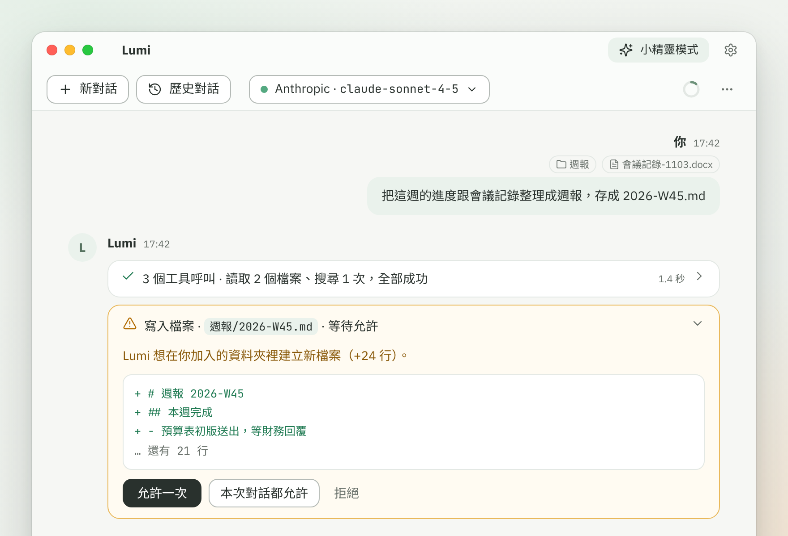

# 工具與權限確認

> Lumi 有哪些內建工具、確認卡片上的按鈕差在哪、允許一次與永遠允許的差別，以及怎麼開關工具。

## 工具是什麼？

工具是 Lumi 在對話中替你「動手」的能力，例如讀檔案、寫檔案、讀網頁、設提醒、操作瀏覽器。模型自己只能回答文字；要做事時，它會先決定呼叫哪個工具，Lumi 執行後把結果交回模型，模型再接著回答。

你不需要自己挑工具，直接說想做的事就好。只讀資料的工具不會問你；會改動資料或連到網路的工具，預設都會先問你。

## 工具卡片怎麼看？

Lumi 每次使用工具，對話裡就會出現一張卡片，標題寫著「動作 · 對象 · 結果」，右邊是耗時。

- 卡片預設收合，點標題可以展開，看到「參數」（Lumi 交給工具的內容）與「結果」。結果很長時按「顯示完整輸出」，按「複製」可以複製。
- 連續 3 次以上的工具呼叫會合成一張，標題像「3 個工具呼叫 · 讀取檔案 2 次、搜尋 1 次，全部成功」。
- 圖示表示狀態：轉圈是執行中，勾是成功，叉是失敗，三角形是等待你的允許，禁止符號是你已拒絕。
- 等待你的允許時，卡片會自動展開，確認按鈕就在裡面。

## 確認卡片的按鈕是什麼意思？

每個工具有一個權限等級，決定要不要問你、怎麼問：

| 權限等級 | 卡片上的說明 | 按鈕 |
|---|---|---|
| 唯讀 | 不會問 | 無 |
| 寫入 | 這個工具要寫入或修改資料 | 「允許一次」「本次對話都允許」「拒絕」 |
| 網路 | 這個工具要連線到網路 | 「允許一次」「本次對話都允許」「拒絕」 |
| 破壞性 | 這個工具要執行刪除或其他不可逆的操作，並標明「這個操作無法復原」 | 「允許執行」「拒絕」 |

卡片會列出這次要做什麼，例如要寫入哪個檔案、新增幾行，請看過再決定。按「拒絕」，工具不會執行，卡片標示「你已拒絕」，Lumi 會知道被拒絕，通常會改問你怎麼做。

## 「允許一次」「本次對話都允許」「永遠允許」差在哪？

- **允許一次**：只允許這一次，下次要用還會再問。
- **本次對話都允許**：這則對話之後不再問。它記的是權限等級，不是單一工具：在一個「寫入」等級的內建工具上選了它，這則對話裡其他「寫入」等級的內建工具也不會再問，「網路」等級同理。選之前請想一下範圍。這個記錄只存在記憶體，每則對話各自一份，重開 Lumi 或刪除對話就沒有了。
- **永遠允許**：到設定 › 工具，把某個工具的「確認方式」改成「永遠允許」。之後所有對話使用這個工具都不再問，立即生效。改的時候會再問一次「確定要永遠允許嗎？」，按「永遠允許」才會設定。要收回，把確認方式改回「每次詢問」。

兩個例外的記法：

- 瀏覽器工具另外記：允許某個瀏覽器工具後，只連帶同權限等級的其他瀏覽器工具，不會連帶「寫入檔案」。見[讓 Lumi 操作瀏覽器](browser.md)。
- 外部工具（MCP）一個一個記：允許一個，不會連帶其他外部工具，即使是同一個伺服器。見[連接外部工具（MCP）](mcp.md)。

## 哪些情況一定會問？

不管設了「永遠允許」或選過「本次對話都允許」，下面這些每次都會問：

- **破壞性的工具**：只有「允許執行」與「拒絕」，不能記住，也不能設永遠允許。內建的有「覆寫檔案」「送出資料到網路 API」「修改記憶」「忘掉」。
- **「建立排程」**：卡片沒有「本次對話都允許」，每次都要確認內容。排程執行時的授權見[提醒、計時器與排程](reminders.md)。
- **對話中沒出現過的網站**：Lumi 要連到你沒提過的網站時，卡片會多一則黃底警告，請你確認是你要連的網站。你自己訊息裡的網址（整個網站都算）、你加入的檔案或前面工具結果裡出現過的完整網址，算「出現過」；Lumi 自己在回答中寫出來的網址不算。允許之後，這則對話不會再為同一個網站警告。
- **搜尋引擎的網址**：Lumi 沒有網路搜尋功能，這種網址每次都問，也不提供「本次對話都允許」。

另外，「記住」「上傳檔案」「等待使用者操作」不能設成「永遠允許」，設定頁的確認方式固定寫「每次都會詢問」。

## 怎麼開關工具、改確認方式？

1. 點右上角的齒輪打開設定視窗，點左邊的「工具」。
2. 在「工具清單」分頁，每個群組有一個總開關，旁邊寫「已啟用 2／3」之類的數量；每個工具各有勾選框，取消勾選就是關閉。
3. 工具名稱旁的徽章是權限等級，「只限工作台」表示小精靈不能用。每列最右邊的「確認方式」可以選「每次詢問」或「永遠允許」；唯讀的寫「不需確認」，不能永遠允許的寫「每次都會詢問」。
4. 最下面的「全部恢復預設」會把所有工具重新啟用，確認方式都改回「每次詢問」。已經是預設時，旁邊會寫「目前已是預設」。

**生效時間不一樣**：開啟或關閉工具，從下一則新對話開始生效，進行中的對話維持原本的工具；確認方式立即生效。

「整理完整內容」是小精靈用來把長內容放到工作台的工具，不能關閉。長期記憶在「記憶」頁關閉時，「長期記憶」群組的工具不會執行。每個工具下面還有一行灰色小字，是給模型看的內部名稱，不用理會。

## 模型關閉「使用工具」會怎樣？

設定 › AI 連線的每個模型都有「使用工具」選項，說明見 [AI 連線與模型](connections.md)。關閉後，用這個模型的對話不會送出任何工具，Lumi 只能用文字回答，不能讀檔或做事。如果預設模型是這樣，設定 › 工具最上方會出現黃底提醒，寫著模型關閉了「啟用工具」，指的就是「使用工具」。

## 小精靈能用哪些工具？

小精靈只能用這些：查使用說明、計算、查詢目前時間、列出資料夾、讀取檔案、讀取文件、搜尋、記筆記、查筆記、搜尋過去對話、建立提醒、啟動計時器、列出提醒、取消提醒、啟用或停用提醒、讀取網頁、列出網頁連結、讀取 RSS、網路診斷、記住、修改記憶、忘掉，以及小精靈專用的「整理完整內容」。

其餘的工具只能在工作台使用，在小精靈用到會失敗，處理方式見[常見問題與錯誤訊息](troubleshooting.md)。小精靈的確認改在氣泡裡進行：「允許」是允許一次，點「更多選項」才有「這則對話都允許」；破壞性的只有「允許刪除」與「拒絕」。

## Lumi 有哪些內建工具？

依設定 › 工具的群組順序，共 52 個。權限是設定頁徽章上的等級；有些工具功能相近，要用哪一個，Lumi 會自己選。

**一般**

| 工具 | 權限 | 說明 |
|---|---|---|
| 查使用說明 | 唯讀 | 查 Lumi 自己的使用說明。 |
| 計算 | 唯讀 | 計算數學算式。 |
| 查詢目前時間 | 唯讀 | 查詢現在的日期與時間。 |

**讀取檔案**（只能讀你加入對話的檔案與資料夾，見[加入檔案與資料夾](files.md)）

| 工具 | 權限 | 說明 |
|---|---|---|
| 列出資料夾 | 唯讀 | 列出你加入的資料夾裡有哪些檔案。 |
| 讀取檔案 | 唯讀 | 讀取你加入的文字檔內容。 |
| 讀取文件 | 唯讀 | 讀取 Word、Excel、PowerPoint、PDF 的文字。 |
| 搜尋 | 唯讀 | 在你加入的檔案裡搜尋文字。 |

**寫入檔案**（只限工作台）

| 工具 | 權限 | 說明 |
|---|---|---|
| 寫入檔案 | 寫入 | 新增檔案，或在檔案結尾加上內容。 |
| 覆寫檔案 | 破壞性 | 用新內容覆蓋整個既有檔案。 |
| 複製檔案 | 寫入 | 複製檔案。 |
| 移動檔案 | 寫入 | 移動檔案或改名。 |
| 建立資料夾 | 寫入 | 建立資料夾。 |

**筆記與對話**

| 工具 | 權限 | 說明 |
|---|---|---|
| 記筆記 | 寫入 | 把一件事記到今天的筆記。 |
| 查筆記 | 唯讀 | 查看之前記的筆記。 |
| 搜尋過去對話 | 唯讀 | 搜尋過去的對話內容。 |
| 讀取過去對話 | 唯讀 | 讀取過去對話的文字與做過的動作（只限工作台）。 |

**提醒與計時**

| 工具 | 權限 | 說明 |
|---|---|---|
| 建立提醒 | 寫入 | 在指定時間提醒你。 |
| 啟動計時器 | 寫入 | 開始倒數計時。 |
| 建立排程 | 寫入 | 在指定時間自動跑一次 prompt（只限工作台）。 |
| 列出提醒 | 唯讀 | 列出目前的提醒與計時器。 |
| 取消提醒 | 寫入 | 取消提醒或計時器。 |
| 啟用或停用提醒 | 寫入 | 暫停或恢復週期提醒。 |

**網路**（網路設定見[網路與 Proxy](network.md)）

| 工具 | 權限 | 說明 |
|---|---|---|
| 讀取網頁 | 網路 | 讀取網址的內容，轉成文字。 |
| 列出網頁連結 | 網路 | 列出網頁上的連結。 |
| 讀取 RSS | 網路 | 讀取 RSS 或 Atom 的最新項目。 |
| 呼叫網路 API | 網路 | 呼叫網路 API，只讀取（GET、HEAD）。只限工作台。 |
| 送出資料到網路 API | 破壞性 | 送出資料到網路 API（POST、PUT、PATCH、DELETE）。只限工作台。 |
| 下載檔案 | 寫入 | 把網址的檔案下載到你加入的資料夾（只限工作台）。 |
| 爬取網站 | 寫入 | 讀取同一個網站裡的幾個頁面，存成 Markdown 檔（只限工作台）。 |
| 網路診斷 | 網路 | 檢查連到某個網址的網路狀況：Proxy、DNS、連線、憑證。 |

**瀏覽器**（全部只限工作台，見[讓 Lumi 操作瀏覽器](browser.md)）

| 工具 | 權限 | 說明 |
|---|---|---|
| 開啟網頁 | 網路 | 用瀏覽器開啟網址，之後可以點擊、輸入與擷取內容。 |
| 查看網頁 | 唯讀 | 查看目前網頁。 |
| 點擊 | 寫入 | 點擊網頁上的按鈕或連結。 |
| 輸入文字 | 寫入 | 在網頁的文字欄位輸入文字。 |
| 按鍵 | 寫入 | 在網頁上按一個鍵。 |
| 選擇選項 | 寫入 | 在網頁的下拉選單選擇選項。 |
| 捲動網頁 | 唯讀 | 捲動網頁。 |
| 回上一頁 | 寫入 | 回到網頁的上一頁。 |
| 擷取網頁內容 | 唯讀 | 擷取目前網頁的文字或表格。 |
| 網頁截圖 | 唯讀 | 網頁截圖。 |
| 下載檔案 | 寫入 | 點擊網頁上的連結，把下載的檔案存到你加入的資料夾。 |
| 上傳檔案 | 寫入 | 把你加入的檔案上傳到網頁。 |
| 等待使用者操作 | 寫入 | 請你在瀏覽器視窗自己完成操作（登入、驗證碼）。 |
| 關閉瀏覽器分頁 | 唯讀 | 關閉這則對話的瀏覽器分頁。 |

**長期記憶**（見[記憶、筆記與過去的對話](memory.md)）

| 工具 | 權限 | 說明 |
|---|---|---|
| 記住 | 寫入 | 記住關於你的長期事實。 |
| 修改記憶 | 破壞性 | 修改一則記憶。 |
| 忘掉 | 破壞性 | 刪除一則記憶。 |

**小精靈**

| 工具 | 權限 | 說明 |
|---|---|---|
| 整理完整內容 | 唯讀 | 把完整內容放到工作台，讓你之後點開查看（只限小精靈，不能關閉）。 |

**圖片**（只限工作台，見[圖片：貼上、產生與編輯](images.md)）

| 工具 | 權限 | 說明 |
|---|---|---|
| 產生圖片 | 網路 | 用設定的模型產生圖片，存到圖片資料夾。 |
| 編輯圖片 | 網路 | 用設定的模型編輯或合成圖片，存成新檔。 |

**塔羅牌**（只限工作台，見[塔羅牌](tarot.md)）

| 工具 | 權限 | 說明 |
|---|---|---|
| 查詢塔羅牌 | 唯讀 | 查詢一張塔羅牌的完整牌義（正位與逆位）。 |
| 塔羅抽牌 | 唯讀 | 洗牌、抽牌並依牌陣擺放，回傳每個位置的牌與牌義。 |

接了外部 MCP 伺服器時，工具清單在內建群組後面會多出每個伺服器各一個群組，見[連接外部工具（MCP）](mcp.md)。

## 相關主題

- [讓 Lumi 操作瀏覽器](browser.md)
- [連接外部工具（MCP）](mcp.md)
- [加入檔案與資料夾](files.md)
- [常見問題與錯誤訊息](troubleshooting.md)
